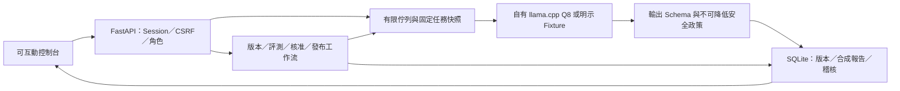

# 版本治理與責任邊界

更新：2026-09-15；0.4.1。本機單安裝、單引擎控制程序，不宣稱多租戶隔離、分散式全域限流或正式雲端部署。

## 版本分工

應用程式0.4.1是產品缺陷修補與資料治理版本；模型權重仍是原Q8的固定SHA，沒有新訓練。提示triage-v4／safety-floor-v2只是通過既有回歸的基線；triage-v5／safety-floor-v3保持未發布。修補候選triage-v5.1／safety-floor-v3.1只取得三組已觀測開發回歸，仍未發布。

服務發布另有release ID及exact bundle／active／previous，由既有核准與真實探針管理。更新應用程式、選沙盒Profile或保存人工結果都不能直接更新active。相同Q8的A/B/A只是服務設定回滾。原始模型、政策後及人工結果分開；人工結果不計入模型品質。

legacy_domain.py及context_quality_v3.py保留舊政策實作；舊報告不自動重算新政策。captured legacy-contract-0.3.0／0.4.0僅在SHA、原引擎與產物、已核准active/previous且非v5/v5.1條件下供既有服務恢復／回滾兼容，不延長效期、不授予舊報告新的發布資格。新評測契約仍綁所有backend來源SHA與固定品質門檻，門檻未降低。

## 三種設定狀態

- **表單草稿**：尚未保存的受限 JSON，預覽無副作用；不是任意可執行 Prompt、SQL、URL 或系統命令。草稿目前保留在頁面，離頁不承諾自動保存。
- **沙盒候選**：管理者明確選擇已保存的不可變設定版本。只影響後續沙盒工作，不直接改正式服務，也不改舊任務。
- **已發布版本**：模型／設定／評測集／封存報告／程式契約的 bundle，經獨立核准及真實探針通過後才成為 active。Q8 自動模式解析此版本；Playground 必填欄位也使用 active，而非頂列候選。

每個工作啟動前保存完整設定快照、model SHA-256、實際生成參數與 release／report hash。設定保存、切換及還原不重綁已啟動工作。還原建立新修訂，不覆寫原設定。

## 權限與核准

operator 可設定／預覽／保存、執行自身推論與評測、提案、查看授權證據；不能操作引擎、核准或切換線上版本。reviewer 可探索授權工作、對別人的固定 bundle 核准／拒絕；不得自批、重複核准或操作引擎。admin 管理帳號、候選、引擎、正式發布／回滾／恢復；admin 不能代替 reviewer 核准。

維修一名獨立 reviewer；設備至少兩名不同獨立 reviewer，再由 admin 明確確認維護時段。此確認是本機操作條件，不宣稱企業時段排程系統。核准綁 bundle hash，重新讀取設定計算所需核准人數，篡改 bundle 的核准數／模型／報告會拒絕。設定修改需新報告與新提案，舊核准不能移植。

## 發布／回滾的真實動作

1. 後端重新檢查 gate、bundle、不同人核准、expected_active_id 與影響確認。
2. 如有執行中或排隊工作，409 拒絕切換；不強制取消或靜默更換參數。評測與發布都使用同一 exclusive 控制槽。
3. 撤下 readiness、核對完整模型與引擎產物清單、啟動／確認本作品引擎，執行正常及高風險兩笔真實 Q8 推論。
4. 實際 model SHA-256／設定／生成參數與政策結果均通過，且報告契約仍有效，才在同一 SQLite transaction 保存 active／previous 指標、探針證據及稽核。
5. 失敗保持舊指標，嘗試舊版真實探針恢復；恢復也失敗則 ready=false，自動正式推論 503。操作任務仍為失敗，不把舊版恢復當此次發布成功。

回滾只允許 previous 已核准可用版本，重新核對當前契約與報告效期並真實推論；恢復只驗證現有 active。這輪 A→B→A 是同一 Q8 權重的**服務設定版本回滾**，不是不同模型權重重載比較。

## 失敗、持久化及限制

重啟將在途推論／評測標為中斷失敗，發布中斷將服務標不可就緒；沒有自動重播副作用。控制台可讀歷史、手動恢復。生成逾時停止本作品自己的引擎，確認底層工作結束後才釋放容量。

一般原文及完整結果僅短期留記憶體，合成評測可以保存逐筆輸入與 raw／post；SQLite／引擎診斷／測試狀態不提交 Git。Secrets 不接受 JSON 明文，匯入未知欄位拒絕，匯出只提供安全設定／合成報告投影。

封存 hash 與本機 append 稽核用於完整性追查，不是外部簽章、不可變儲存或防止本機系統管理者修改資料庫的證明。已有MLflow實驗同步、Prometheus指標格式出口、業務備份及新隔離還原工作台；MLflow不管理active/released。尚無Model Registry、Prometheus服務端實跑、不同權重／路由、多副本、Shadow／Canary。完整服務Linux容器仍需環境與引擎adapter验证，見[容器邊界](容器部署設定.md)。

複核來源預設記憶體15分鐘，明確同意待複核來源本機7日；人工摘要／理由／歷史與政策無自動到期且可能含私人資料。專用複核業務備份須管理者內容預覽與另行確認，原始證據一律排除，還原只新建缺來源的唯讀安裝，不能成為發布證據。詳見[生命週期契約](複核資料生命週期與備份契約.md)。
