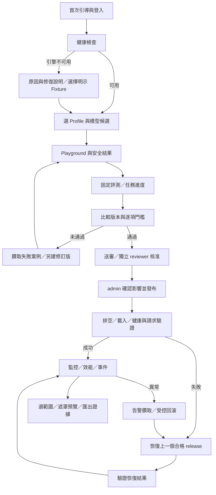

# 頁面與低擬真互動流程

狀態：2026-09-14 設計提案。這是文字線框與可追讀流程，不是已接後端的可點擊網站，不含模擬成功或假進度。

## 全域版面

```text
┌─────────────────────────────────────────────────────────┐
│ 原創產品名  [Profile／設定版] [真實／Fixture]  角色／登出 │
├───────────┬─────────────────────────────────────────────┤
│ 首頁健康  │ 頁名／目的／目前狀態／最後更新時間           │
│ 模型      │ 主要動作    [查看影響] [執行或送審]          │
│ 客製設定  │                                             │
│ Playground│ 表單／結果／比較圖／事件時間軸               │
│ 評測比較  │                                             │
│ 發布部署  │ 選一個結果 → 右側抽屜                        │
│ 任務      │ ID、版本、狀態、原因、來源證據               │
│ 效能      │                                             │
│ 監控告警  │ 頁內錯誤與恢復動作；未連線不顯示綠色成功     │
│ Trace稽核 │                                             │
│ 匯出      │ 全域任務入口／待複核數                       │
└───────────┴─────────────────────────────────────────────┘
```

頂列 Profile 控制新任务預設及檢視篩選，不會切換登入者身分，也不會直接改線上 release。每張卡都顯示 actual profile_version／model_version／evidence_kind。手機版側欄收合、比較表可橫捲，焦點可依序到達主要操作；圖表附資料表。

## 主要旅程



Fixture 走測試沙盒旅程，不能從 G 進入真實發布；「產品不可用」與「可用 Fixture」並列，不能自動混用 Provider。

## 十一個頁面

| ID／頁面 | 線框區塊 | 主要互動與真實回饋 |
|---|---|---|
| P01 首次引導／環境健康 | 一次性管理者建立 → 登入；RAM／GPU／模型／DB／MLflow／Prometheus／容器狀態卡 | 重測健康；選合成範例與 Profile；查看依賴原因；引導建一般人及 reviewer 帳號。未安裝系統工具只說明，不能網頁擅自安裝 |
| P02 模型與 Provider | 模型卡列表；來源／license／revision／SHA；Provider 能力表；匯入抽屜 | 選本作品 staging 檔／上傳 manifest；驗證 hash；查看來源缺口；選候選；測連線；禁止手填任意 URL。驗證中／拒絕／待評測明確区分 |
| P03 客製化設定 | 草稿／版本；品牌／欄位／Prompt／門檻／資源／核准／告警分頁；右侧同案例預覽 | 表單編輯、驗證、存草稿、比較、送審、核准後確認套用、匯入匯出、還原預設／上一版；指出新任务受影響與正在執行的任務保持版本 |
| P04 推論 Playground | 左：Profile／模型／任務表單；右：已驗證結果、原文證據、缺欄、複核理由、耗時 | 送出、取消、查看 queue、合成案例重播、提交結果複核；診斷分頁顯示受限真實串流。候選推論標沙盒，無法當線上版本 |
| P05 評測與版本比較 | 資料集／生成契約；版本多選；品質／延遲／資源圖；門檻表與案例表 | 啟動固定評測；查看完成筆數；比較同契約；篩選失敗與風險；鑽取原始及政策後結果；對合格 bundle 送審；不同契約顯示不可作公平比較 |
| P06 發布與部署工作台 | 待審收件匣；bundle 差異；核准鏈；單實例拓樸；發布步驟；previous-good | reviewer 核准／拒絕；admin 查看影響、發布、維護、取消尚未執行提案、重試／重啟／回滾；顯示實際程序狀態及失敗理由 |
| P07 任務佇列與進度 | 按種類／狀態／Profile／時間篩選；執行中及等待列表；容量格與任務抽屜 | 查看階段／heartbeat／已完成數；取消自己的排隊工作；可恢復重試建立新 task 並連到 parent。生成工作無可靠總量時不顯示百分比 |
| P08 效能測試工作台 | 固定案例／預熱／併發／總量表單；執行限制與影響確認；P50/P95／吞吐／資源圖 | 啟動、停止負載、比較報告；點資料點看樣本與 trace；待測 TTFT 顯 N/A；負載測試任務與日常佇列爭用需提示 |
| P09 監控與告警 | 部署健康、RAM/VRAM、queue、錯誤／超時率；告警列表；時間範圍 | 篩選、zoom、圖表選區→任務／Trace；確認告警、查門檻版本；可連結 P06 受控回滾；確認告警不等於解除故障 |
| P10 Trace／事件／稽核 | 搜尋 ID／角色／版本／結果；HTTP→queue→engine→policy 瀑布；核准與發布時間軸 | 展開遮罩細節、關聯 task/release/report；合成案例可依原版本另建重播；稽核只讀，不可任意改歷史 |
| P11 證據及報告匯出 | 選任务／版本／測試報告／格式；將排除資訊預覽；匯出工作與校驗；備份／還原分頁 | 建立非敏感 JSON/CSV/Markdown 包、下載、驗證 hash；admin 在維護狀態執行一致性備份／還原；還原失敗保留舊狀態 |

## 五個重要操作的逐步線框

### 設定差異與套用

```text
P03 編輯草稿
左欄：[事件必填欄位] [複核條件] [核准模板] [資源預算]
右欄：同一合成事件 → 輸入接受／缺欄／需要哪個角色
[驗證] → 欄位下方原因／修正方式
[比較] → 舊值 │ 新值 │ 影響的新任務 │ 是否需重新評測
[送審] → proposal_id＋bundle hash（不是套用成功）
reviewer：[核准／退回與理由]
有權者：[確認套用 vN] → 後端成功後刷新 active config
[還原上一版] → 產生草稿 vN+1 → 同一核准流程
```

品牌／儀表板屬呈現設定；模型、Prompt、Schema、policy 變更要使既有候選的評測資格失效。草稿預覽不能改正在執行任務或線上發布版本。

### 評測與失敗候選

```text
P05 選模型 A、模型 B、同一資料集／生成設定
[執行] → P07 queued → running（已完成 n／總筆數）
結果：raw 指標 │ policy 後指標 │ threshold │ 原因
點失敗數 → 案例原始輸出／正式安全結果／來源文字
合格候選：[送審]
不合格候選：[修訂設定] [重跑新任務]；不提供繞過硬門檻
```

### 發布、故障與回滾

```text
P06 已核准 bundle → 確認「會暫停接新請求，預計步驟如下」
draining → unloading → loading → verifying → active
每一階段顯示已發生事件及最後 heartbeat，不使用估計百分比。
verifying 失敗 → recovery_required／restoring_previous
上一版 hash／授權／政策資格確認 → 載入 → 送固定推論 → recovered
恢復仍失敗：保持 not_ready，列錯誤原因及可重試入口。
```

部署拓樸節點為 API、queue、engine、MLflow、Prometheus、state；點節點顯示健康來源、檢查時間與相關事件。未跑 Compose 時拓樸明示本機程序，不畫成容器或 Kubernetes 副本。

### 推論與人工複核

```text
P04 輸入 → queued → generating → validating
→ completed（正式結果）／needs_review（原因與原文證據）／failed
needs_review → reviewer 查看原輸出及政策後結果 → 批准／退回＋理由
人工決策另存新紀錄；不覆寫原模型輸出，也不會自動成為訓練資料。
一般人無權時：說明需要 reviewer，保留可讀結果及提交狀態。
```

### 匯出

```text
P11 選 release／run → 查看格式與包含內容 → 遮罩預覽
[建立匯出] → queued → scanning → ready／blocked
ready → 下載＋manifest hash；blocked → 欄位類型與修正提示，不回顯秘密
```

## 狀態與可用性規則

每個資料頁必須有：載入中、無資料、驗證錯誤、成功、失敗、逾時、無權限與恢復指引。空資料不畫零值曲線；未監測顯示「尚無樣本」。斷線顯示資料時間與過期狀態，不維持假健康。

副作用前先給影響與確認；後端仍核對 session、角色、版本與核准，不相信前端選項。不可用操作顯示具體原因與下一步；完全不在範圍的功能不放無效按鈕。

持續任務顯示服務回傳的階段、已完成工作單位或不定量等待。取消請求、停止產生新負載與模型真正停止三者分開。重试建立新 attempt，保留原始失敗紀錄。

本文件流程的實作驗證對應[覆蓋矩陣](功能互動覆蓋矩陣.md)。
